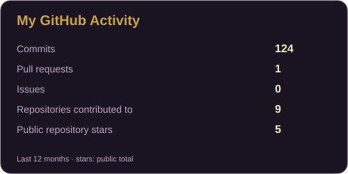
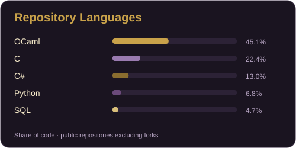

<div align="center">


</div>

---

```text
$ cat about.txt

Name       : Marwane EL FADILY
Username   : SangFuu
Education  : Third-year Computer Science student
Languages  : C, Java, OCaml, C#, C++, Python
Web & data : HTML, CSS, XML, SQL, PHP
Framework  : Symfony
Interests  : Algorithms, data structures,
             software development
```

## About Me

I am a third-year Computer Science student building my skills through university and personal projects. I enjoy understanding how algorithms work, choosing suitable data structures, and turning ideas into working programs.

## Projects

### 🎲 Board Game Score Assistant

A team project in **C**, using an **SQLite** database to track scores and manage rules for several board games.

### 🌳 Binary Search Trees

An **OCaml** project exploring binary search trees, tree rebuilding, and scapegoat trees.

## Tools


## GitHub Activity

<div align="center">





</div>

## Links

<a href="https://sangfuu.github.io/"></a>
[](https://www.linkedin.com/in/marwane-el-fadily-8449a1333/)
[](mailto:marwaneelfadily@gmail.com)
