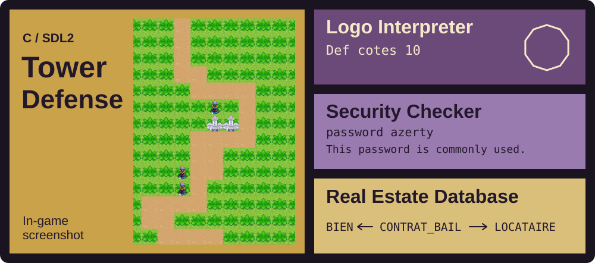

---

| | |
|---|---|
| **Name** | Marwane EL FADILY |
| **Username** | SangFuu |
| **Education** | Third-year Computer Science student |
| **Languages** | C, Java, OCaml, C#, C++, Python |
| **Web & data** | HTML, CSS, XML, SQL, PHP |
| **Framework** | Symfony |
| **Interests** | Algorithms, data structures, software development |

## About Me

I am a third-year Computer Science student building my skills through university and personal projects. I enjoy understanding how algorithms work, choosing suitable data structures, and turning ideas into working programs.

## Selected Work

### [Tower Defense](https://github.com/SangFuu/tower-defense)

SAID PAUL and I made this in C with SDL2. The defenses are placed automatically, so you can watch a run, pause it and save it. We used two save formats. The text one is handy if you're moving a save between Windows and Linux.

### [Logo Interpreter](https://github.com/SangFuu/logo-interpreter)

Adnane Serrai and I built a Logo interpreter in OCaml for a language theory class. I worked on expressions, variables, loops and error handling. The final version is in `src/`, the exercise steps in `history/`, and there are [example programs](https://github.com/SangFuu/logo-interpreter/tree/main/examples) with screenshots.

### [Local Security Checker](https://github.com/SangFuu/open-source-security-checker)

A Python command-line tool that checks passwords (entropy, common passwords, optional Have I Been Pwned lookup) and HTML login forms (password sent with GET, HTTP action, missing CSRF token). The example above uses `azerty`, which it flags as a common password.

### [Real Estate Database](https://github.com/SangFuu/real-estate-database)

Adnane Serrai and I designed a database for a fictional real estate agency. I worked on the table relationships, SQL queries and forms. The schema is also available in standard SQL with constraints and an entity-relationship diagram, so it runs on SQLite or PostgreSQL without LibreOffice.

## Tools

## GitHub Activity

## Links

